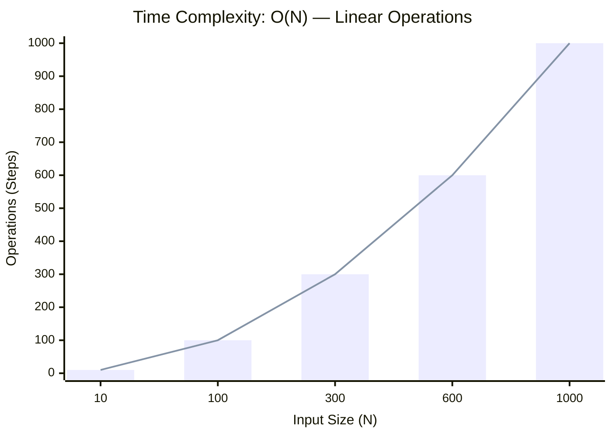

<h2><a href="https://codeforces.com/contest/2274/problem/B">2274B. 2268A</a></h2><h3>Easy</h3>

B. Prefix

time limit per test
1 second

memory limit per test
256 megabytes

input
standard input

output
standard output

You are given an array <nobr aria-hidden="true">a1,a2,…,an</nobr><math xmlns="http://www.w3.org/1998/Math/MathML"><msub><mi>a</mi><mn>1</mn></msub><mo>,</mo><msub><mi>a</mi><mn>2</mn></msub><mo>,</mo><mo>…</mo><mo>,</mo><msub><mi>a</mi><mi>n</mi></msub></math>. 

For each index <nobr aria-hidden="true">i=2,3,…,n</nobr><math xmlns="http://www.w3.org/1998/Math/MathML"><mi>i</mi><mo>=</mo><mn>2</mn><mo>,</mo><mn>3</mn><mo>,</mo><mo>…</mo><mo>,</mo><mi>n</mi></math> in order, perform the following:
<ul> <li> Define <nobr aria-hidden="true">s=a1+a2+…+ai−1</nobr><math xmlns="http://www.w3.org/1998/Math/MathML"><mi>s</mi><mo>=</mo><msub><mi>a</mi><mn>1</mn></msub><mo>+</mo><msub><mi>a</mi><mn>2</mn></msub><mo>+</mo><mo>…</mo><mo>+</mo><msub><mi>a</mi><mrow class="MJX-TeXAtom-ORD"><mi>i</mi><mo>−</mo><mn>1</mn></mrow></msub></math>. </li><li> Replace <nobr aria-hidden="true">ai</nobr><math xmlns="http://www.w3.org/1998/Math/MathML"><msub><mi>a</mi><mi>i</mi></msub></math> with one of the following three values: <nobr aria-hidden="true">ai−s</nobr><math xmlns="http://www.w3.org/1998/Math/MathML"><msub><mi>a</mi><mi>i</mi></msub><mo>−</mo><mi>s</mi></math>, <nobr aria-hidden="true">ai</nobr><math xmlns="http://www.w3.org/1998/Math/MathML"><msub><mi>a</mi><mi>i</mi></msub></math>, or <nobr aria-hidden="true">ai+s</nobr><math xmlns="http://www.w3.org/1998/Math/MathML"><msub><mi>a</mi><mi>i</mi></msub><mo>+</mo><mi>s</mi></math>. </li></ul>
Over all possible choices, find the maximum value of <nobr aria-hidden="true">max(a1,a2,…,an)</nobr><math xmlns="http://www.w3.org/1998/Math/MathML"><mo movablelimits="true" form="prefix">max</mo><mo stretchy="false">(</mo><msub><mi>a</mi><mn>1</mn></msub><mo>,</mo><msub><mi>a</mi><mn>2</mn></msub><mo>,</mo><mo>…</mo><mo>,</mo><msub><mi>a</mi><mi>n</mi></msub><mo stretchy="false">)</mo></math> after the process described above.

Input

Each test contains multiple test cases. The first line contains the number of test cases <nobr aria-hidden="true">t</nobr><math xmlns="http://www.w3.org/1998/Math/MathML"><mi>t</mi></math> (<nobr aria-hidden="true">1≤t≤104</nobr><math xmlns="http://www.w3.org/1998/Math/MathML"><mn>1</mn><mo>≤</mo><mi>t</mi><mo>≤</mo><msup><mn>10</mn><mn>4</mn></msup></math>). The description of the test cases follows.

The first line of each test case contains a single integer <nobr aria-hidden="true">n</nobr><math xmlns="http://www.w3.org/1998/Math/MathML"><mi>n</mi></math> (<nobr aria-hidden="true">2≤n≤50</nobr><math xmlns="http://www.w3.org/1998/Math/MathML"><mn>2</mn><mo>≤</mo><mi>n</mi><mo>≤</mo><mn>50</mn></math>).

The second line of each test case contains <nobr aria-hidden="true">n</nobr><math xmlns="http://www.w3.org/1998/Math/MathML"><mi>n</mi></math> integers <nobr aria-hidden="true">a1,a2,…,an</nobr><math xmlns="http://www.w3.org/1998/Math/MathML"><msub><mi>a</mi><mn>1</mn></msub><mo>,</mo><msub><mi>a</mi><mn>2</mn></msub><mo>,</mo><mo>…</mo><mo>,</mo><msub><mi>a</mi><mi>n</mi></msub></math> (<nobr aria-hidden="true">−50≤ai≤50</nobr><math xmlns="http://www.w3.org/1998/Math/MathML"><mo>−</mo><mn>50</mn><mo>≤</mo><msub><mi>a</mi><mi>i</mi></msub><mo>≤</mo><mn>50</mn></math>).

Output

For each test case, output a single integer — the maximum achievable value of <nobr aria-hidden="true">max(a1,a2,…,an)</nobr><math xmlns="http://www.w3.org/1998/Math/MathML"><mo movablelimits="true" form="prefix">max</mo><mo stretchy="false">(</mo><msub><mi>a</mi><mn>1</mn></msub><mo>,</mo><msub><mi>a</mi><mn>2</mn></msub><mo>,</mo><mo>…</mo><mo>,</mo><msub><mi>a</mi><mi>n</mi></msub><mo stretchy="false">)</mo></math>.

Please note that the answer for some test cases won't fit into a 32-bit integer type, so you should use at least a 64-bit integer type in your programming language (like long long in C++).

Example

Input
Copy

<pre id="id003096137842139407">
4

5

3 -5 1 -4 2

2

-1 2

3

1 2 3

3

-2 -2 -2
</pre>

Output
Copy

<pre id="id007522514952338663">
24

3

7

4
</pre>

Note

In the first test case, the final array can be made <nobr aria-hidden="true">[3,−8,−4,−13,24]</nobr><math xmlns="http://www.w3.org/1998/Math/MathML"><mo stretchy="false">[</mo><mn>3</mn><mo>,</mo><mo>−</mo><mn>8</mn><mo>,</mo><mo>−</mo><mn>4</mn><mo>,</mo><mo>−</mo><mn>13</mn><mo>,</mo><mn>24</mn><mo stretchy="false">]</mo></math>, so the answer is <nobr aria-hidden="true">24</nobr><math xmlns="http://www.w3.org/1998/Math/MathML"><mn>24</mn></math>.

In the second test case, for <nobr aria-hidden="true">i=2</nobr><math xmlns="http://www.w3.org/1998/Math/MathML"><mi>i</mi><mo>=</mo><mn>2</mn></math>, <nobr aria-hidden="true">s=a1=−1</nobr><math xmlns="http://www.w3.org/1998/Math/MathML"><mi>s</mi><mo>=</mo><msub><mi>a</mi><mn>1</mn></msub><mo>=</mo><mo>−</mo><mn>1</mn></math>. Replacing <nobr aria-hidden="true">a2</nobr><math xmlns="http://www.w3.org/1998/Math/MathML"><msub><mi>a</mi><mn>2</mn></msub></math> with <nobr aria-hidden="true">a2−s=2−(−1)=3</nobr><math xmlns="http://www.w3.org/1998/Math/MathML"><msub><mi>a</mi><mn>2</mn></msub><mo>−</mo><mi>s</mi><mo>=</mo><mn>2</mn><mo>−</mo><mo stretchy="false">(</mo><mo>−</mo><mn>1</mn><mo stretchy="false">)</mo><mo>=</mo><mn>3</mn></math> gives the answer <nobr aria-hidden="true">3</nobr><math xmlns="http://www.w3.org/1998/Math/MathML"><mn>3</mn></math>.

In the third test case, the final array can be made <nobr aria-hidden="true">[1,3,7]</nobr><math xmlns="http://www.w3.org/1998/Math/MathML"><mo stretchy="false">[</mo><mn>1</mn><mo>,</mo><mn>3</mn><mo>,</mo><mn>7</mn><mo stretchy="false">]</mo></math>, so the answer is <nobr aria-hidden="true">7</nobr><math xmlns="http://www.w3.org/1998/Math/MathML"><mn>7</mn></math>.

In the fourth test case, replacing <nobr aria-hidden="true">a2</nobr><math xmlns="http://www.w3.org/1998/Math/MathML"><msub><mi>a</mi><mn>2</mn></msub></math> with <nobr aria-hidden="true">a2+s=−4</nobr><math xmlns="http://www.w3.org/1998/Math/MathML"><msub><mi>a</mi><mn>2</mn></msub><mo>+</mo><mi>s</mi><mo>=</mo><mo>−</mo><mn>4</mn></math> makes <nobr aria-hidden="true">s=−6</nobr><math xmlns="http://www.w3.org/1998/Math/MathML"><mi>s</mi><mo>=</mo><mo>−</mo><mn>6</mn></math> for <nobr aria-hidden="true">i=3</nobr><math xmlns="http://www.w3.org/1998/Math/MathML"><mi>i</mi><mo>=</mo><mn>3</mn></math>. Replacing <nobr aria-hidden="true">a3</nobr><math xmlns="http://www.w3.org/1998/Math/MathML"><msub><mi>a</mi><mn>3</mn></msub></math> with <nobr aria-hidden="true">a3−s=−2−(−6)=4</nobr><math xmlns="http://www.w3.org/1998/Math/MathML"><msub><mi>a</mi><mn>3</mn></msub><mo>−</mo><mi>s</mi><mo>=</mo><mo>−</mo><mn>2</mn><mo>−</mo><mo stretchy="false">(</mo><mo>−</mo><mn>6</mn><mo stretchy="false">)</mo><mo>=</mo><mn>4</mn></math> gives the final array <nobr aria-hidden="true">[−2,−4,4]</nobr><math xmlns="http://www.w3.org/1998/Math/MathML"><mo stretchy="false">[</mo><mo>−</mo><mn>2</mn><mo>,</mo><mo>−</mo><mn>4</mn><mo>,</mo><mn>4</mn><mo stretchy="false">]</mo></math>, so the answer is <nobr aria-hidden="true">4</nobr><math xmlns="http://www.w3.org/1998/Math/MathML"><mn>4</mn></math>.

### 📊 Submission Statistics
- **Language:** `cpp`
- **Runtime:** `46 ms`
- **Memory:** `0 MB`
- **Submission Date:** Fri, 16 Oct 2026 15:15:29 GMT

---

### 💡 Approach & Complexity Analysis
#### 🧠 Intuition & Algorithmic Strategy
- **Approach:** Linear scan and greedy state accumulation to resolve **2268A**.
- **Flow:**
  1. Initialize state variables and inspect base constraints.
  2. Iterate through input elements, maintaining current progress and boundaries.
  3. Return the calculated result satisfying problem criteria.

#### ⏱️ Complexity Analysis
- **Time Complexity:** $\mathcal{O}(V + E) \text{ or } \mathcal{O}(2^N)$ — *Recursive exploration visiting paths across the decision space.*
- **Space Complexity:** $\mathcal{O}(N)$ — *Auxiliary lookup table or dynamically allocated buffer storing input elements.*

#### 📈 Time Complexity Graph (Operations vs Input Size $N$)

#### 📦 Space Complexity Graph (Memory Footprint vs Input Size $N$)

---
*Auto-synced with [LeetGitSyncPro](https://synccode-pro.pages.dev)*
