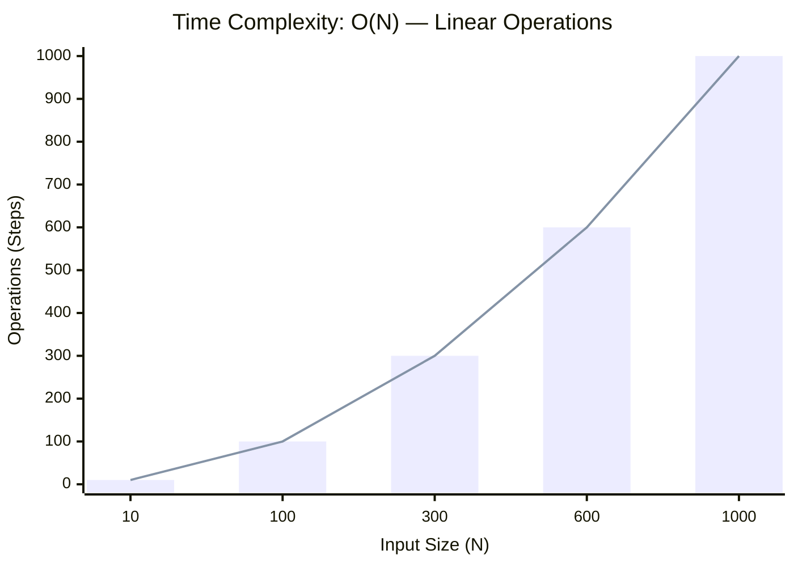
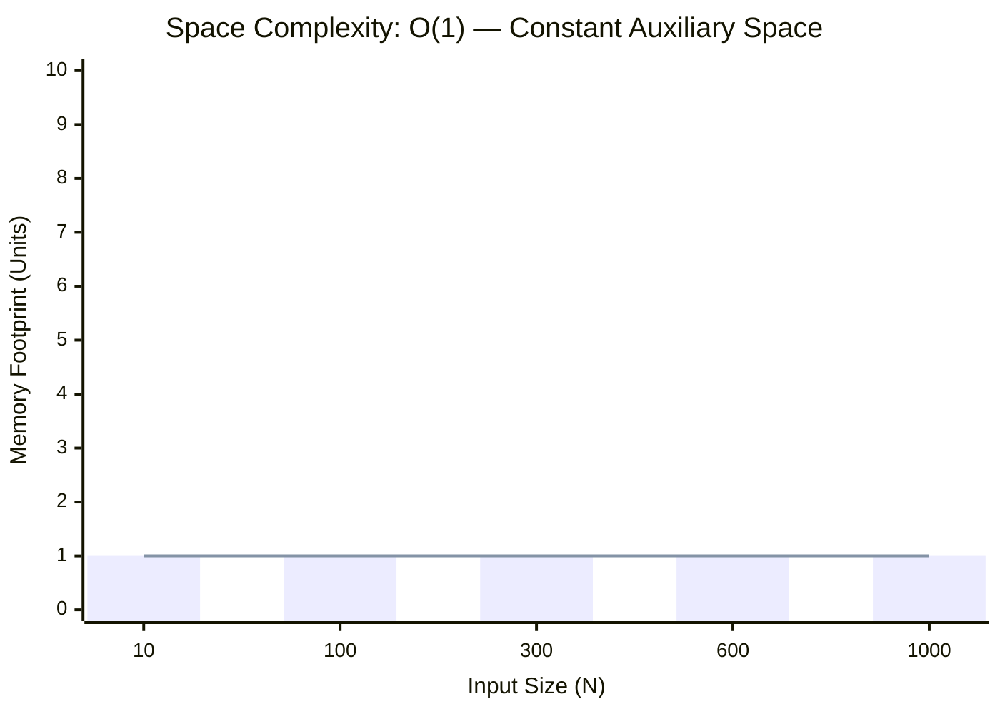

<h2><a href="https://www.geeksforgeeks.org/problems/geek-hates-too-many-1s--170647/1">Maximum Without 3 Consecutive Set Bits</a></h2><h3>Medium</h3>

Given a non-negative integer <strong>n</strong>, you can only change a set bit (1) to an unset bit (0). Find the maximum possible value of n such that its binary representation does not contain three consecutive set bits (111)&nbsp;after performing zero or more allowed operations.

<strong>Examples:</strong>
<pre><strong>Input:</strong> n = 2
<strong>Output:</strong> 2
<strong>Explanation: </strong>The binary representation of 2 is 10, which does not contain three consecutive set bits. Therefore, no change is required.</pre><pre><strong>Input: </strong>n = 7
<strong>Output: </strong>6
<strong>Explanation: </strong>The binary representation of 7 is 111, which contains three consecutive set bits. Changing the rightmost set bit to 0 gives: 111 -&gt; 110. Thus, the maximum possible value is 6.
</pre>

### 📊 Submission Statistics
- **Language:** `cpp`
- **Runtime:** `1115s (1115000ms)`
- **Memory:** `N/A`
- **Test Cases:** `1115 / 1115 Passed`
- **Accuracy:** `58.04%`
- **Submission Date:** Fri, 16 Oct 2026 12:04:43 GMT

---

### 💡 Approach & Complexity Analysis
#### 🧠 Intuition & Algorithmic Strategy
- **Approach:** Linear scan and greedy state accumulation to resolve **Maximum Without 3 Consecutive Set Bits**.
- **Flow:**
  1. Initialize state variables and inspect base constraints.
  2. Iterate through input elements, maintaining current progress and boundaries.
  3. Return the calculated result satisfying problem criteria.

#### ⏱️ Complexity Analysis
- **Time Complexity:** $\mathcal{O}(N)$ — *Single linear pass over the input collection.*
- **Space Complexity:** $\mathcal{O}(1)$ — *In-place execution using only a constant number of auxiliary pointer variables.*

#### 📈 Time Complexity Graph (Operations vs Input Size $N$)

#### 📦 Space Complexity Graph (Memory Footprint vs Input Size $N$)

---
*Auto-synced with [LeetGitSyncPro](https://synccode-pro-18m.pages.dev)*
