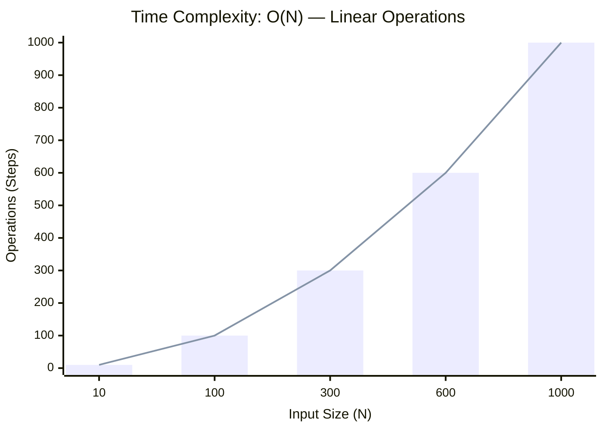

<h2><a href="https://leetcode.com/problems/move-zeroes/">Move Zeroes</a></h2><h3>Easy</h3>

Given an integer array <code>nums</code>, move all <code>0</code>'s to the end of it while maintaining the relative order of the non-zero elements.

<strong>Note</strong> that you must do this in-place without making a copy of the array.

&nbsp;

<strong class="example">Example 1:</strong>

<pre><strong>Input:</strong> nums = [0,1,0,3,12]
<strong>Output:</strong> [1,3,12,0,0]
</pre>
<strong class="example">Example 2:</strong>

<pre><strong>Input:</strong> nums = [0]
<strong>Output:</strong> [0]
</pre>

&nbsp;

<strong>Constraints:</strong>

<ul>
	<li><code>1 &lt;= nums.length &lt;= 104</code></li>
	<li><code>-231 &lt;= nums[i] &lt;= 231 - 1</code></li>
</ul>

&nbsp;

<strong>Follow up:</strong> Could you minimize the total number of operations done?

### 📊 Submission Statistics
- **Language:** `cpp`
- **Runtime:** `0 ms`
- **Memory:** `N/A`
- **Submission Date:** Fri, 16 Oct 2026 16:20:02 GMT

---

### 💡 Approach & Complexity Analysis
#### 🧠 Intuition & Algorithmic Strategy
- **Approach:** Linear scan and greedy state accumulation to resolve **Move Zeroes**.
- **Flow:**
  1. Initialize state variables and inspect base constraints.
  2. Iterate through input elements, maintaining current progress and boundaries.
  3. Return the calculated result satisfying problem criteria.

#### ⏱️ Complexity Analysis
- **Time Complexity:** $\mathcal{O}(N)$ — *Single linear pass over the input collection.*
- **Space Complexity:** $\mathcal{O}(N)$ — *Auxiliary lookup table or dynamically allocated buffer storing input elements.*

#### 📈 Time Complexity Graph (Operations vs Input Size $N$)

#### 📦 Space Complexity Graph (Memory Footprint vs Input Size $N$)

---
*Auto-synced with [LeetGitSyncPro](https://synccode-pro.pages.dev)*
