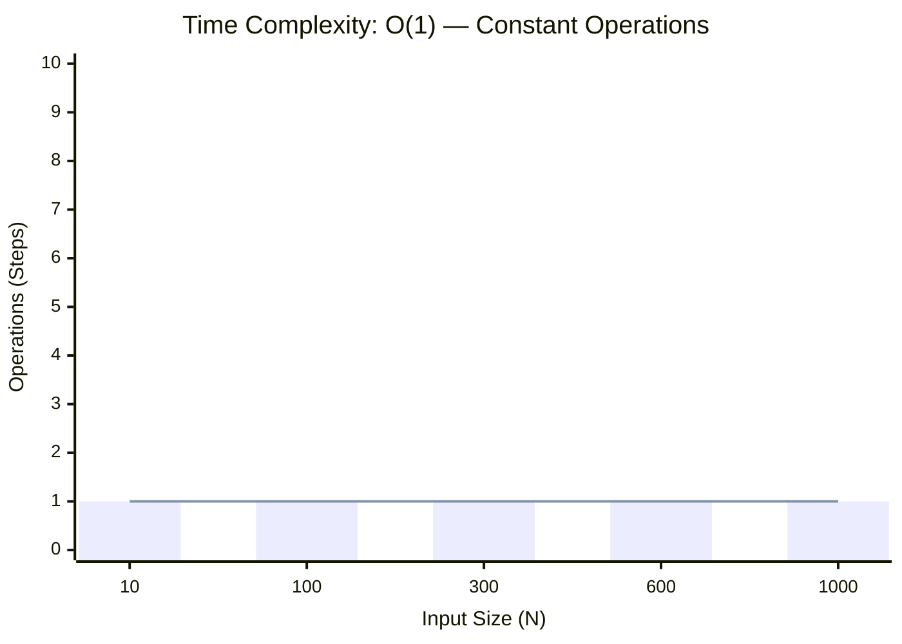
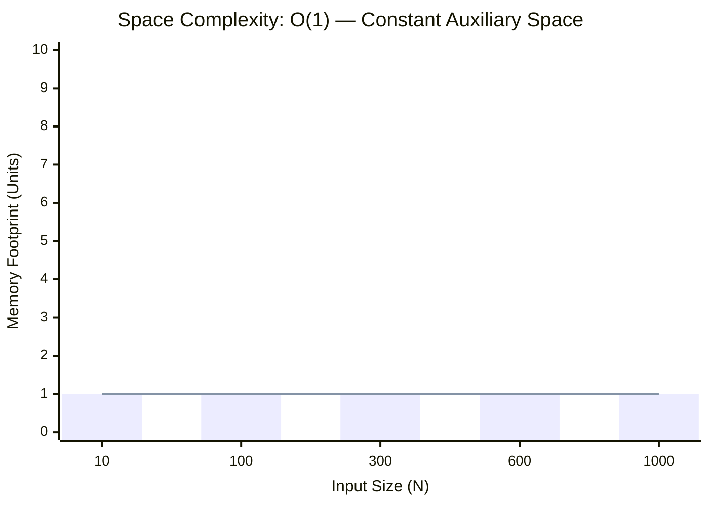

<h2><a href="https://www.geeksforgeeks.org/problems/pass-by-reference-and-value/1">Pass by Reference and Value</a></h2><h3>Easy</h3>

Given two integers<strong> a</strong> and <strong>b</strong>, add 1 to <strong>a</strong> and 2 to <strong>b</strong>. The parameter a is passed by value, while <strong>b</strong> is passed by reference. Return the resulting values as an array of two integers.

<strong>Examples:</strong>

<pre><strong>Input: </strong>a = 1, b = 2
<strong>Output: </strong>[2, 4]
<strong>Explanation:</strong> 1 was passed by value whereas 2 passed by reference.</pre>
<pre><strong>Input: </strong>a = 10, b = 20
<strong>Output: </strong>[2, 4]  <strong style="background-color: #f4f4f4; font-family: monospace; white-space: pre-wrap;">Explanation:</strong> 10 is increased by 1, and 20 is increased by 2.</pre>

### 📊 Submission Statistics
- **Language:** `cpp`
- **Runtime:** `1110s (1110000ms)`
- **Memory:** `N/A`
- **Test Cases:** `1110 / 1110 Passed`
- **Accuracy:** `75.16%`
- **Submission Date:** Fri, 16 Oct 2026 13:08:48 GMT

---

### 💡 Approach & Complexity Analysis
#### 🧠 Intuition & Algorithmic Strategy
- **Approach:** Direct constant-time evaluation using bit manipulation, formulas, or branchless operations.
- **Flow:**
  1. Initialize state variables and inspect base constraints.
  2. Iterate through input elements, maintaining current progress and boundaries.
  3. Return the calculated result satisfying problem criteria.

#### ⏱️ Complexity Analysis
- **Time Complexity:** $\mathcal{O}(1)$ — *Constant time operations with direct arithmetic or state manipulation.*
- **Space Complexity:** $\mathcal{O}(1)$ — *In-place execution using only a constant number of auxiliary pointer variables.*

#### 📈 Time Complexity Graph (Operations vs Input Size $N$)

#### 📦 Space Complexity Graph (Memory Footprint vs Input Size $N$)

---
*Auto-synced with [LeetGitSyncPro](https://synccode-pro.pages.dev)*
