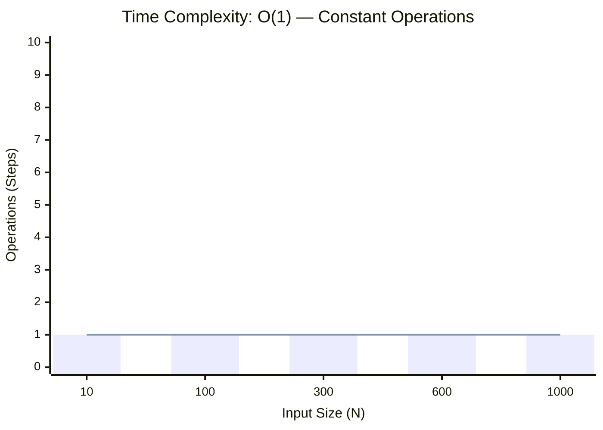
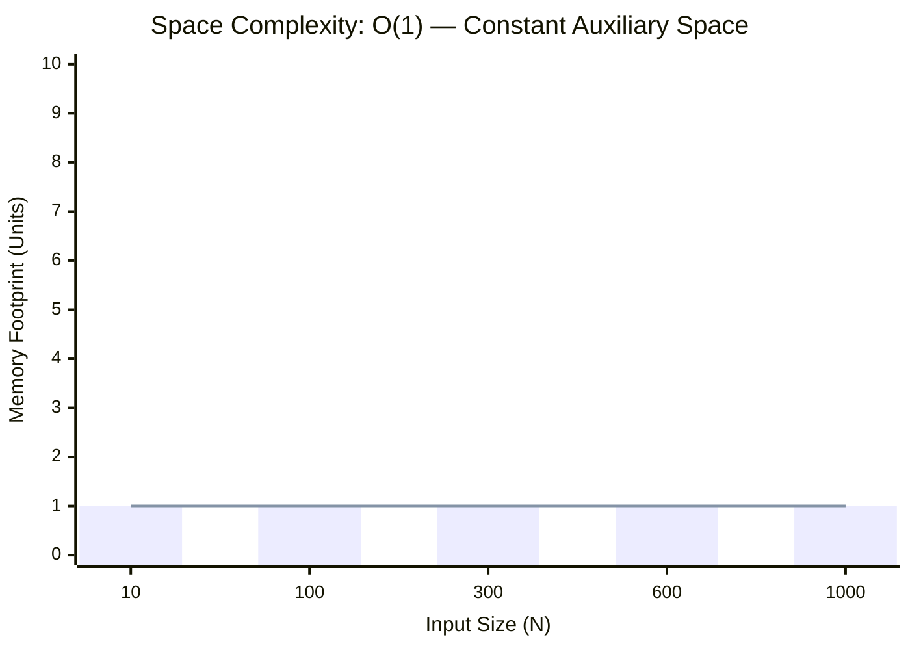

<h2><a href="https://www.naukri.com/code360/problems/reverse-the-array_1262298">Reverse The Array</a></h2><h3>Hard</h3>

<h4 id="given-an-array-list-arr-of-integers-and-a-position-m-you-have-to-reverse-the-array-after-that-position">Given an array/list &#39;ARR&#39; of integers and a position ‘M’. You have to reverse the array after that position.</h4>

<h4 id="example">Example:</h4>

<pre><code>We have an array ARR = {1, 2, 3, 4, 5, 6} and M = 3 , considering 0 
based indexing so the subarray {5, 6} will be reversed and our 
output array will be {1, 2, 3, 4, 6, 5}.
</code></pre>

<h5 id="input-format">Input format:</h5>

<pre><code>The very first line of input contains an integer ‘T’ denoting the number of test cases. 

The first line of every test case contains one integer ‘N’ where ‘N’ denotes the number of elements and an integer ‘M’ which denotes after which position the array has to be reversed.

The second line of every test case contains ‘N’ space-separated integers which denote the elements of input of array/list.
</code></pre>

<h5 id="output-format">Output format:</h5>

<pre><code>For each test case, return the required array.

Output for each test case is printed on a separate line.
</code></pre>

<h5 id="note">Note:</h5>

<pre><code>You do not need to print anything, it has already been taken care of. Just implement the given function.

Consider 0-based indexing of the array.
</code></pre>

<h5 id="constraints">Constraints:</h5>

<pre><code>1 &lt;= T &lt;= 10
0 &lt;= M &lt;= N &lt;= 5*10^4
-10^9 &lt;= ARR[i] &lt;= 10^9

Time Limit: 1 sec
</code></pre>

### 📊 Submission Statistics
- **Language:** `cpp`
- **Runtime:** `16 ms` (Beats **99.94%**)
- **Memory:** `N/A`
- **Test Cases:** `11 / 11 Passed`
- **Submission Date:** Fri, 16 Oct 2026 15:57:47 GMT

---

### 💡 Approach & Complexity Analysis
#### 🧠 Intuition & Algorithmic Strategy
- **Approach:** Direct constant-time evaluation using bit manipulation, formulas, or branchless operations.
- **Flow:**
  1. Initialize state variables and inspect base constraints.
  2. Iterate through input elements, maintaining current progress and boundaries.
  3. Return the calculated result satisfying problem criteria.

#### ⏱️ Complexity Analysis
- **Time Complexity:** $\mathcal{O}(1)$ — *Constant time operations with direct arithmetic or state manipulation.*
- **Space Complexity:** $\mathcal{O}(1)$ — *In-place execution using only a constant number of auxiliary pointer variables.*

#### 📈 Time Complexity Graph (Operations vs Input Size $N$)

#### 📦 Space Complexity Graph (Memory Footprint vs Input Size $N$)

---
*Auto-synced with [LeetGitSyncPro](https://synccode-pro.pages.dev)*
