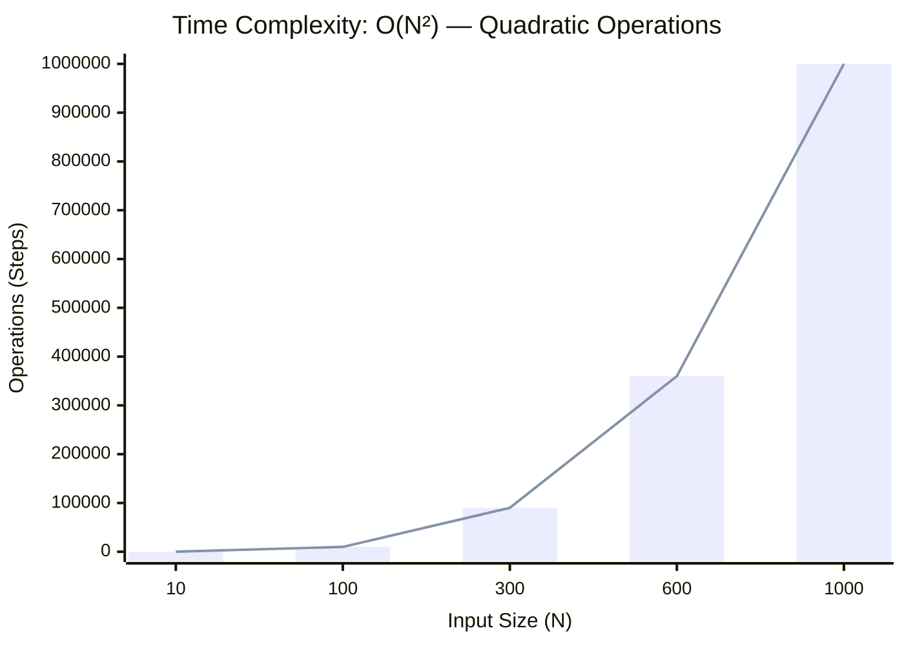
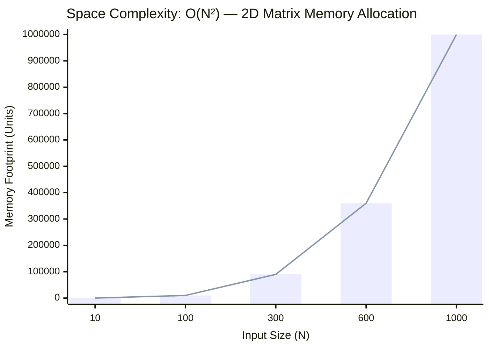

<h2><a href="https://leetcode.com/problems/shortest-bridge/">Shortest Bridge</a></h2><h3>Medium</h3>

You are given an <code>n x n</code> binary matrix <code>grid</code> where <code>1</code> represents land and <code>0</code> represents water.

An <strong>island</strong> is a 4-directionally connected group of <code>1</code>'s not connected to any other <code>1</code>'s. There are <strong>exactly two islands</strong> in <code>grid</code>.

You may change <code>0</code>'s to <code>1</code>'s to connect the two islands to form <strong>one island</strong>.

Return <em>the smallest number of </em><code>0</code><em>'s you must flip to connect the two islands</em>.

&nbsp;

<strong class="example">Example 1:</strong>

<pre><strong>Input:</strong> grid = [[0,1],[1,0]]
<strong>Output:</strong> 1
</pre>

<strong class="example">Example 2:</strong>

<pre><strong>Input:</strong> grid = [[0,1,0],[0,0,0],[0,0,1]]
<strong>Output:</strong> 2
</pre>

<strong class="example">Example 3:</strong>

<pre><strong>Input:</strong> grid = [[1,1,1,1,1],[1,0,0,0,1],[1,0,1,0,1],[1,0,0,0,1],[1,1,1,1,1]]
<strong>Output:</strong> 1
</pre>

&nbsp;

<strong>Constraints:</strong>

<ul>
	<li><code>n == grid.length == grid[i].length</code></li>
	<li><code>2 &lt;= n &lt;= 100</code></li>
	<li><code>grid[i][j]</code> is either <code>0</code> or <code>1</code>.</li>
	<li>There are exactly two islands in <code>grid</code>.</li>
</ul>

### 📊 Submission Statistics
- **Language:** `cpp`
- **Runtime:** `0 ms`
- **Memory:** `N/A`
- **Submission Date:** Fri, 16 Oct 2026 09:36:37 GMT

---

### 💡 Approach & Complexity Analysis
#### 🧠 Intuition & Algorithmic Strategy
- **Approach:** Linear scan and greedy state accumulation to resolve **Shortest Bridge**.
- **Flow:**
  1. Initialize state variables and inspect base constraints.
  2. Iterate through input elements, maintaining current progress and boundaries.
  3. Return the calculated result satisfying problem criteria.

#### ⏱️ Complexity Analysis
- **Time Complexity:** $\mathcal{O}(N^3)$ — *Three levels of nested iteration across elements.*
- **Space Complexity:** $\mathcal{O}(N \times M) \text{ or } \mathcal{O}(N^2)$ — *2D matrix or dynamic programming grid allocated for state transitions.*

#### 📈 Time Complexity Graph (Operations vs Input Size $N$)

#### 📦 Space Complexity Graph (Memory Footprint vs Input Size $N$)

---
*Auto-synced with [LeetGitSyncPro](https://synccode-pro.pages.dev)*
