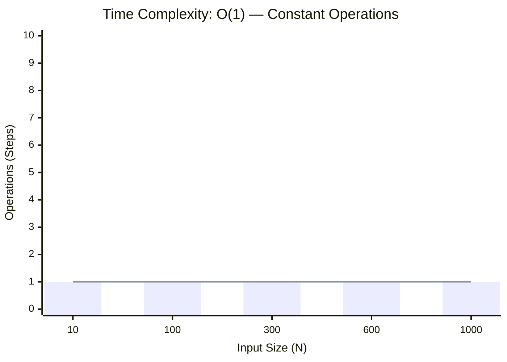
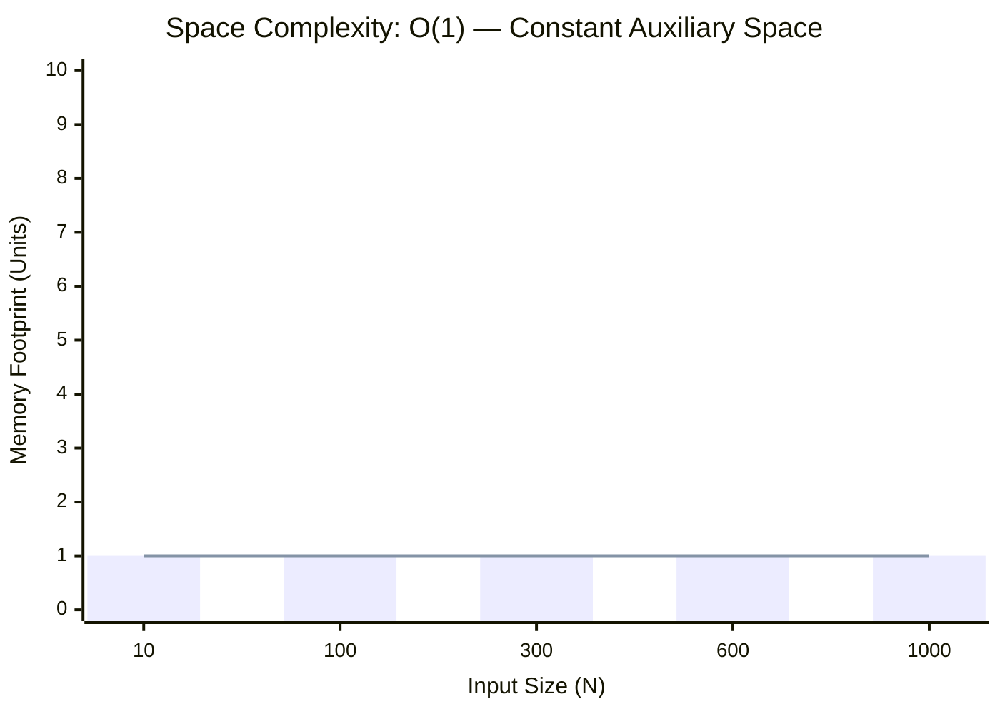

<h2><a href="https://leetcode.com/problems/shortest-distance-to-a-character/">Shortest Distance to a Character</a></h2><h3>Easy</h3>

Given a string <code>s</code> and a character <code>c</code> that occurs in <code>s</code>, return <em>an array of integers </em><code>answer</code><em> where </em><code>answer.length == s.length</code><em> and </em><code>answer[i]</code><em> is the <strong>distance</strong> from index </em><code>i</code><em> to the <strong>closest</strong> occurrence of character </em><code>c</code><em> in </em><code>s</code>.

The <strong>distance</strong> between two indices <code>i</code> and <code>j</code> is <code>abs(i - j)</code>, where <code>abs</code> is the absolute value function.

&nbsp;

<strong class="example">Example 1:</strong>

<pre><strong>Input:</strong> s = "loveleetcode", c = "e"
<strong>Output:</strong> [3,2,1,0,1,0,0,1,2,2,1,0]
<strong>Explanation:</strong> The character 'e' appears at indices 3, 5, 6, and 11 (0-indexed).
The closest occurrence of 'e' for index 0 is at index 3, so the distance is abs(0 - 3) = 3.
The closest occurrence of 'e' for index 1 is at index 3, so the distance is abs(1 - 3) = 2.
For index 4, there is a tie between the 'e' at index 3 and the 'e' at index 5, but the distance is still the same: abs(4 - 3) == abs(4 - 5) = 1.
The closest occurrence of 'e' for index 8 is at index 6, so the distance is abs(8 - 6) = 2.
</pre>

<strong class="example">Example 2:</strong>

<pre><strong>Input:</strong> s = "aaab", c = "b"
<strong>Output:</strong> [3,2,1,0]
</pre>

&nbsp;

<strong>Constraints:</strong>

<ul>
	<li><code>1 &lt;= s.length &lt;= 104</code></li>
	<li><code>s[i]</code> and <code>c</code> are lowercase English letters.</li>
	<li>It is guaranteed that <code>c</code> occurs at least once in <code>s</code>.</li>
</ul>

### 📊 Submission Statistics
- **Language:** `cpp`
- **Runtime:** `0 ms`
- **Memory:** `N/A`
- **Submission Date:** Fri, 16 Oct 2026 09:30:58 GMT

---

### 💡 Approach & Complexity Analysis
#### 🧠 Intuition & Algorithmic Strategy
- **Approach:** Direct constant-time evaluation using bit manipulation, formulas, or branchless operations.
- **Flow:**
  1. Initialize state variables and inspect base constraints.
  2. Iterate through input elements, maintaining current progress and boundaries.
  3. Return the calculated result satisfying problem criteria.

#### ⏱️ Complexity Analysis
- **Time Complexity:** $\mathcal{O}(1)$ — *Constant time operations with direct arithmetic or state manipulation.*
- **Space Complexity:** $\mathcal{O}(1)$ — *In-place execution using only a constant number of auxiliary pointer variables.*

#### 📈 Time Complexity Graph (Operations vs Input Size $N$)

#### 📦 Space Complexity Graph (Memory Footprint vs Input Size $N$)

---
*Auto-synced with [LeetGitSyncPro](https://synccode-pro.pages.dev)*
