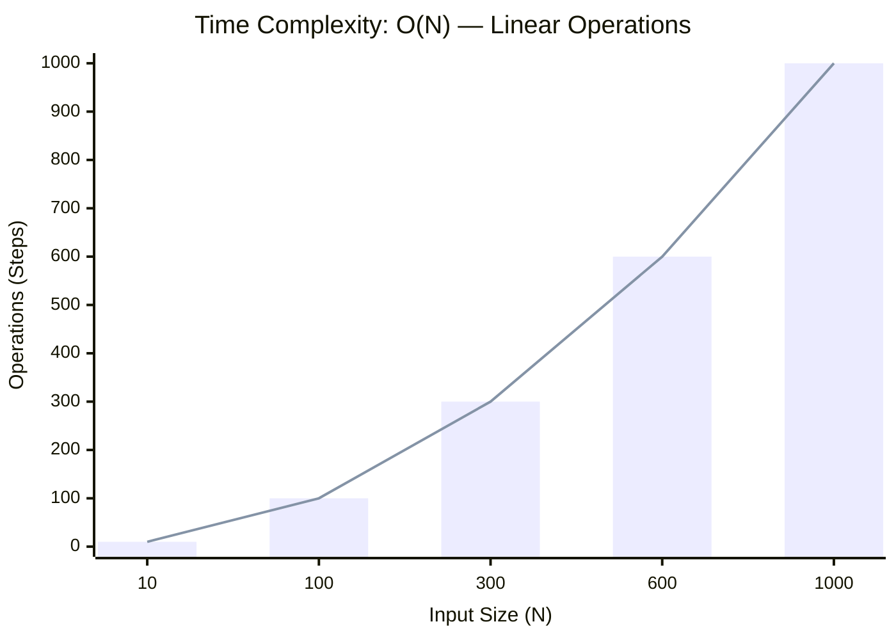

<h2><a href="https://leetcode.com/problems/two-sum/">Two Sum</a></h2><h3>Easy</h3>

You are given an array of integers <code>nums</code>&nbsp;and an integer <code>target</code>, return <em>indices of the two numbers such that they add up to <code>target</code></em>.

You may assume that each input would have <strong><em>exactly</em> one solution</strong>, and you may not use the <em>same</em> element twice.

You can return the answer in any order.

&nbsp;

<strong class="example">Example 1:</strong>

<pre><strong>Input:</strong> nums = [2,7,11,15], target = 9
<strong>Output:</strong> [0,1]
<strong>Explanation:</strong> Because nums[0] + nums[1] == 9, we return [0, 1].
</pre>

<strong class="example">Example 2:</strong>

<pre><strong>Input:</strong> nums = [3,2,4], target = 6
<strong>Output:</strong> [1,2]
</pre>

<strong class="example">Example 3:</strong>

<pre><strong>Input:</strong> nums = [3,3], target = 6
<strong>Output:</strong> [0,1]
</pre>

&nbsp;

<strong>Constraints:</strong>

<ul>
	<li><code>2 &lt;= nums.length &lt;= 104</code></li>
	<li><code>-109 &lt;= nums[i] &lt;= 109</code></li>
	<li><code>-109 &lt;= target &lt;= 109</code></li>
	<li><strong>Only one valid answer exists.</strong></li>
</ul>

&nbsp;

<strong>Follow-up:&nbsp;</strong>Can you come up with an algorithm that is less than <code>O(n2)</code>&nbsp;time complexity?

### 📊 Submission Statistics
- **Language:** `cpp`
- **Runtime:** `0 ms`
- **Memory:** `N/A`
- **Submission Date:** Fri, 16 Oct 2026 07:24:04 GMT

---

### 💡 Approach & Complexity Analysis
#### 🧠 Intuition & Algorithmic Strategy
- **Approach:** Two-pointer convergence squeezing the search window towards the target boundaries.
- **Flow:**
  1. Initialize state variables and inspect base constraints.
  2. Iterate through input elements, maintaining current progress and boundaries.
  3. Return the calculated result satisfying problem criteria.

#### ⏱️ Complexity Analysis
- **Time Complexity:** $\mathcal{O}(N)$ — *Single linear pass over the input collection.*
- **Space Complexity:** $\mathcal{O}(N)$ — *Auxiliary lookup table or dynamically allocated buffer storing input elements.*

#### 📈 Time Complexity Graph (Operations vs Input Size $N$)

#### 📦 Space Complexity Graph (Memory Footprint vs Input Size $N$)

---
*Auto-synced with [LeetGitSyncPro](https://synccode-pro.pages.dev)*
